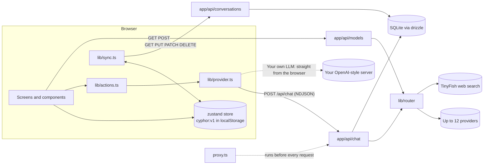

# Architecture

The shape of Cyphor Chat: what runs where, how a message travels, how conversations are stored and kept in sync, and where to change what. Read it with [FILE-MAP.md](./FILE-MAP.md) open, which says what each file is for.

## 1. The shape

- **The browser is the main copy.** Chats live in the browser's `localStorage` and work with the server off. The server keeps a copy when saving is switched on (Settings > Privacy > Server copy), so a conversation follows you to another browser only through that copy, and only for the same visitor id.
- **The server holds the keys.** Provider keys are read from `LLM.env` on the server and never sent to the browser. The one exception is "Your own LLM" in Settings > Model, which sends requests straight from the browser to an address you type, with the key you typed (stored in this browser). See [ENV-AND-SECURITY.md](./ENV-AND-SECURITY.md).
- **Nothing is connected? It still answers.** With no provider key, `lib/mock.ts` is the demo model, so the app can always be tried.

## 2. The folders

| Folder | Holds |
| --- | --- |
| `app/` | Next.js App Router: the page files, `layout.tsx`, `globals.css`, and `api/` (the four routes). |
| `components/` | The screens and parts: shell, sidebar, chat view, composer, message, model picker, artifact panel, command palette, dialogs. `components/settings/` has one file per settings tab. `components/ui/` is the shadcn library. |
| `lib/` | Browser logic (store, actions, sync, provider, parse, prompt, files, import and export, motion, theme), the server helpers (`http.ts`, `rate-limit.ts`, `retry.ts`, `basic-auth.ts`, `chat-messages.ts`) and `lib/router/`, the router. |
| `db/` | The two tables and the code that opens the database. |
| `proxy.ts` | The gate in front of every request. |
| `tests/` | `unit/` (Node's test runner) and `e2e/` (Playwright and axe-core). |
| `preview/` | Only for the one-file preview build. |

Routes: `/` (new chat), `/chat` (list), `/chat/<id>`, `/projects`, `/projects/<id>`, `/artifacts`. They all draw inside the same shell; `lib/route.ts` is the one place that maps a path to a screen and back.

## 3. The data

A conversation is a **tree** of messages. Editing a message or retrying a reply does not overwrite anything: it adds a sibling under the same parent, and `activeChildId` remembers which branch is on screen (`rootActiveId` does the same for the first message). The thread you see, and the one sent to the model, is the path down the active children (`activeThread` and `pathTo` in `lib/store.ts`).

The same shape is stored twice:

| | Browser | Server |
| --- | --- | --- |
| Where | `localStorage` key `cyphor:v1` (zustand `persist`, version 1) | SQLite file `.data/cyphor.db`, or the `DATABASE_URL` you set (a Turso address works) |
| Holds | `settings`, `chats` (as `nodes` by id), `projects` | `conversations` and `messages` (one row per message; the tree is rebuilt from `parent_id`) |
| Not kept | Incognito chats are never written. A reply still streaming is saved as `stopped`. Image bytes are dropped. | Image bytes are never stored (name, type, size and extracted text are). Projects and settings are not on the server. |
| Writes | Batched, 500 ms after the last change, and at once when the page is hidden | Each save replaces a conversation in one batch |

The tables (`db/schema.ts`):

- `conversations`: `id`, `owner_id` (the visitor id from `proxy.ts`), `title`, `starred`, `project_id`, `model`, `root_active_id`, `created_at`, `updated_at`, with an index on `(owner_id, updated_at)`.
- `messages`: primary key `(conversation_id, id)` with `ON DELETE CASCADE`; `parent_id`, `role`, `content`, `model`, `attachments` (JSON), `active_child_id`, `feedback`, `status`, `error`, `thinking_ms`, `meta` (JSON: how the router made the reply), `created_at`.

The tables are created the first time the database is opened (`BOOTSTRAP_SQL` in `db/index.ts`), so a fresh checkout needs no migration step. A column added after the first release goes in `LATER_COLUMNS` there, so an older database gets it when it is opened. A unit test (in `tests/unit/server-lib.test.ts`) fails if the tables made by `BOOTSTRAP_SQL` and the definitions in `db/schema.ts` have different columns, and another opens an old database and checks the column is added without losing a row. `drizzle.config.ts` is only for the optional `npm run db:*` commands.

## 4. A message's trip

1. **Send.** The composer calls `sendMessage` in `lib/actions.ts`. It adds the user message at the end of the visible thread, gives the chat a title from the first message if it still has the default one, and calls `run`. Editing (`editMessage`) and retrying (`retryMessage`) go through the same `run`; they add siblings.
2. **Prepare.** `run` builds the system prompt (`lib/prompt.ts`: your settings, the chosen response style, the project's instructions), adds an empty assistant message marked streaming, takes the path to the new user message, and creates one `AbortController` for this chat. The stop button calls `stopGenerating`, which aborts it.
3. **Choose the source.** `streamReply` in `lib/provider.ts` picks one of three:
   - Settings > Model > **Cyphor server** (the default): `POST /api/chat` on this app.
   - Settings > Model > **Your own LLM**: straight from the browser to the address in Settings.
   - The one-file preview: the demo model only; nothing is called.
4. **Server.** For `/api/chat` the server checks the request, picks a model, saves the turn, streams the reply as lines of JSON and then finishes the turn in the database. The whole contract is in [API.md](./API.md); how a model is picked is in [ROUTER-AND-GOD-MODE.md](./ROUTER-AND-GOD-MODE.md).
5. **Render.** Text pieces are added to the message as they arrive and written to the store at most every 60 ms, so the screen stays smooth. Route, council and web-source notes arrive as separate lines and are patched onto the message (`onMeta`). When a reply opens an `<artifact`, the artifact panel opens by itself on screens 1024 px wide or more.
6. **Finish.** The message gets its final text, `status` (`done`, `stopped` or `error`), the error text if any, and `thinkingMs` when the reply had a `<thinking>` part.

## 5. Saving and syncing (`lib/sync.ts`)

Runs only in the real app (not in the preview) and only when Settings > Privacy > Server copy is on. Everything below is in `lib/sync.ts`.

- **Pushing.** When a chat changes, a save is scheduled 1.5 seconds later (`DEBOUNCE_MS`, restarting on each change) and sent as `PUT /api/conversations/<id>`. A failed save is retried after 15 seconds (`RETRY_MS`). The status (off, idle, syncing, offline, error) is what the sync indicator shows.
- **Never sent:** incognito chats, and a chat that is still streaming (it is sent when it finishes). Image bytes are removed before sending.
- **Reconciling.** At start, when saving is switched on, and when the browser comes back online, the browser lists the server's conversations and compares `updatedAt`. The newer side wins, in either direction. Chats the server has never seen are pushed. A chat just copied down is not pushed back.
- **Deleting.** Deleting a chat sends `DELETE` for it (if the browser is offline the server keeps its copy until the next delete-all). "Erase everything" sends `DELETE /api/conversations` first and waits at most 3 seconds before the page reloads.

## 6. The server's front door

- `proxy.ts` runs for every request: the optional shared password, the anonymous visitor cookie, refusal of cross-site writes, security headers. [API.md](./API.md) section 1.
- `lib/http.ts` is what each route calls first: `guard(req, name, perMinute, envName)` (visitor id plus rate limits), `readJson(req, maxBytes)` (size-capped body) and `apiError(status, code, message, headers)` (the one error shape).
- `lib/chat-messages.ts` is the single place that checks what a client sends (`LIMITS`, `checkChat`, `checkChatRequest`) and converts between the browser's tree, database rows and model messages.
- Anything that leaves the server as words goes through `scrubSecrets` first, so a key a provider echoes back in an error never reaches the screen.

## 7. Changing things: where to look

| You want to | Change these | Then |
| --- | --- | --- |
| Add an API route | `app/api/<name>/route.ts`, starting with `guard` and `readJson`, answering with `apiError` for errors | Describe it in [API.md](./API.md); add tests in `tests/unit/server-lib.test.ts` |
| Store one more field on a message | `lib/types.ts`, `db/schema.ts`, `BOOTSTRAP_SQL` and `LATER_COLUMNS` in `db/index.ts`, and the checks and converters in `lib/chat-messages.ts` | Run the unit tests; they compare table and schema |
| Add a setting | `Settings` in `lib/types.ts`, its default in `DEFAULT_SETTINGS` (`lib/defaults.ts`), the control in a `components/settings/*.tsx` tab | Old saved data gets the default automatically (saved settings are merged over the defaults when the store loads) |
| Add a settings tab | `SettingsTab` in `lib/ui.ts`, a new file in `components/settings/`, the `TABS` list in `components/settings/dialog.tsx` | Add its text to [UI-AND-DESIGN.md](./UI-AND-DESIGN.md) |
| Add a Cyphor model name | `VIRTUAL_KINDS` and the planning in `lib/router/planner.ts`, the entry in `DEFAULT_MODELS` (`lib/models/page.ts`) | See [ROUTER-AND-GOD-MODE.md](./ROUTER-AND-GOD-MODE.md) section 14 |
| Add a provider | `lib/router/provider-defs.ts` and `.env.example` | Same section 14 |
| Add a screen | A `page.tsx` under `app/`, and `lib/route.ts` | Check the sidebar and command palette know it |
| Add a shadcn component | `npx shadcn@latest add <name>` (configured by `components.json`) | Do not restyle files in `components/ui/`; style them from the app's own components |
| Change colours, type or motion | `app/globals.css` and `DESIGN.md` together | [UI-AND-DESIGN.md](./UI-AND-DESIGN.md) |

After any change run the type check and the unit tests. [TESTING.md](./TESTING.md) lists the commands.
